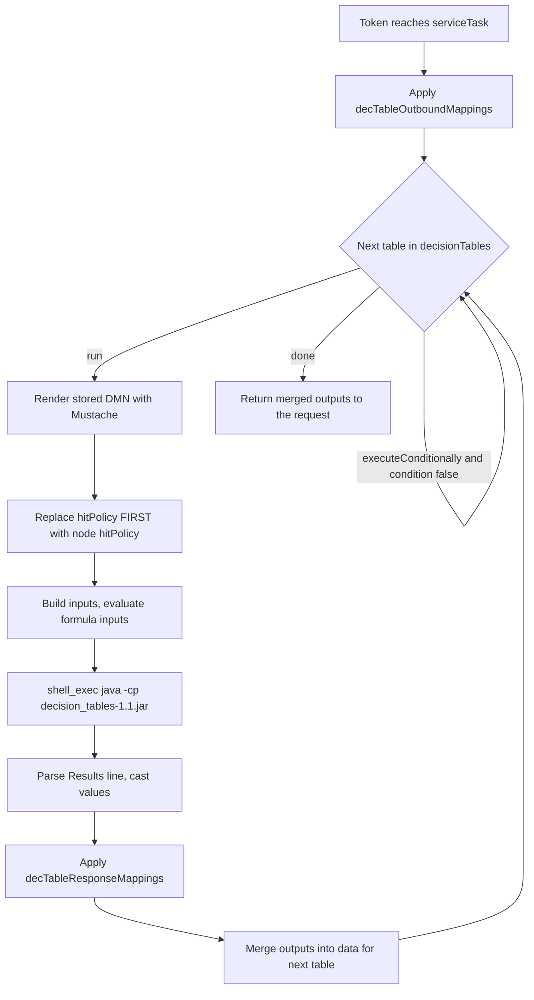

# How a Decision Task runs

Source: `package-decision-engine/src/DecisionTableImplementation.php`, registered as a service task implementation in `PackageServiceProvider::boot()`:

```php
WorkflowManager::registerServiceImplementation('package-decision-engine/decision-table', DecisionTableImplementation::class);
```

A Decision Task is a service task, so it runs on the **queue worker**, not in the browser.

## Flow



## Steps in detail

1. **Outbound mappings.** For each `{requestVar, tableVar}`, `data[tableVar] = data[requestVar]`, only if `requestVar` exists.
2. **Condition.** If `executeConditionally` is true and `condition` is not empty, the condition is evaluated over the current data. Falsy skips the table. See [Conditions and formulas](#conditions-and-formulas-are-not-dmn-feel) for the syntax.
3. **Mustache render.** The stored DMN text is rendered with request data before it runs:
   - `{{var}}` inserts a request value. `Helpers/DataAccess` throws `Variable 'x' does not exists or is empty.` when `var` is missing **or null**.
   - Magic variables: `run()` removes `_request` and `_user` and adds `_request_id`, `_task_name`, and `_task_user_id`. So `{{_request_id}}` and `{{_task_name}}` work, but `{{_request.id}}` and `{{_user.id}}` fail with `Variable '_request' does not exists or is empty.` (The official docs say Magic Variables are available; only these flat ones are.)
   - `{{#_collection}}"Name".<id>.<field>{{/_collection}}` reads a Collection record. See [collections.md](collections.md).
   - Values are escaped (`addslashes` + `htmlspecialchars`) before insertion.
4. **Hit policy.** The code does `str_replace(' hitPolicy="FIRST" ', ...)` with the node's `hitPolicy`. Aggregators become `COLLECT" aggregation="SUM` etc. If the stored DMN does not contain exactly ` hitPolicy="FIRST" ` (spaces included), the replacement silently does nothing and the table runs as FIRST. DMN generated by the editor or by `definition_arrays` always matches; hand-written DMN may not.
5. **Inputs.** For each DMN `inputData`:
   - If its `variable` has a `formula` attribute whose `expression` differs from the input name, the expression is evaluated, and booleans become `"true"`/`"false"`. A request variable with the input's name is ignored.
   - Otherwise the value comes from the mapped request variable (or the same name). Missing → exception, token fails, even when every rule has `-` for that input.
   - Booleans from request data use PHP truthiness: `false`, `0`, `""` → `false`, but the **string `"false"` → `true`**. Everything else is sent as a string, with the DMN `typeRef` alongside.
   - The engine converts `number`, `date` (ISO `YYYY-MM-DD`), `time`, and `boolean`. A value that fails conversion (e.g. `12/01/2025` for a date) is silently passed as a string, so date rules just don't match.
6. **Engine.** The DMN, inputs, and types are base64-encoded and passed to `java -cp tables-engine/target/decision_tables-1.1.jar com.processmaker.decision_tables.App` through `shell_exec`. **The host running the queue worker must have Java on its `PATH`.**
7. **Parse.** The first output line must start with `Results:`. Anything else throws `Table Decision evaluation had errors: <line>` (no rule matched, Java missing, invalid FEEL in a cell, malformed DMN, UNIQUE/ANY conflicts). Values are cast per hit policy; see [hit-policies.md](hit-policies.md).
8. **Response mappings.** Each output is written to its mapped `requestVar`, or under its own name. The outbound-mapped copies (`tableVar`) are not saved to the request.
9. **Chain.** Outputs merge into the data **under their mapped name**, so the next table in `decisionTables` sees them. Response mappings apply to every table on the node: if `band` is mapped to `size`, a later table that reads `band` fails with `The variable 'band' does not exist in the request data`.

## Conditions and formulas are not DMN FEEL

Rule cells are DMN FEEL, evaluated by the Java engine. The node `condition` and formula `expression`s are evaluated in PHP by ProcessMaker's `FormalExpression`, the same syntax as gateway conditions. ProcessMaker's docs call that syntax "FEEL Expression Syntax" too, but it is Symfony-based and differs from DMN FEEL:

| | Rule cell (DMN FEEL) | Condition / formula (ProcessMaker syntax) |
|--|----------------------|---------------------|
| Equals | `"gold"` | `tier == "gold"` (`=` fails: `Unexpected character "="`) |
| Logic | `> 10`, `[1..10]`, `not(5)` | `amount > 100 and tier != "gold"`, `not approved` |
| Lists and ranges | `"a","b"`, `[1..10]` | `tier in ["gold", "silver"]`, `amount in 1..10` |
| Refer to the column value | `?`: `contains(?, "Kate")` | the variable name |
| Missing variable | n/a | Fails the token: `Undefined variable "x"` |

To call a FEEL function on the column's own value, use `?`. The docs' suggestion of `contains("{{full_name}}", "Kate")` returns a boolean that is then compared with the input, so it never matches.

Every enabled condition is evaluated. A condition on an earlier table's output fails when that table was skipped, so only reference variables that always exist.

A formula input is created only when `inputTypes[i]` is `"formula"` and `formulas[i]` is `{"expression": "amount * 2", "type": "number"}`. With any other input type the formula is ignored and the input is read from request data.

## Column types

Use `string`, `number`, `boolean`, `date`, or `time`. **Date and time together do not work:** the editor's `datetime` and Excel's `Date/Time` fail to compile (`Unable to create KieModule`), and `date and time` compiles but the value is passed as a string, so rules never match. The official docs document `datetime` as `YYYY-MM-DD HH:MM:SS`; that does not work here. Use a `date` column, or a `string` column holding ISO text compared as text.

## The stored DMN

`decision_tables.definition` holds DMN 1.3 XML (`http://www.omg.org/spec/DMN/20180521/MODEL/`) in the shape `Managers/DmnCreator` produces:

- one `inputData` + `variable` per input (a `formula` JSON attribute when the input is a formula),
- one `decision` with one `decisionTable`, `hitPolicy="FIRST"`,
- `input` / `output` columns and `rule` rows whose `inputEntry` / `outputEntry` text is FEEL (`"gold"`, `> 100`, `[1..10]`, `-`).

Prefer generating it through `PUT /api/1.0/decision_tables/{id}` with `definition_arrays` over writing XML. Example: [examples/decision-table.dmn.xml](examples/decision-table.dmn.xml), [examples/definition-arrays.json](examples/definition-arrays.json).

## Modeler

Modeler loads the node through the decision engine's modeler script (`public/js/decision-tables/decision-tables-connector.js`, registered with `registerModelerScript`). For each BPMN type, `Modeler.vue` tries parsers in the order custom → implementation → default. The Decision Task matches only when `implementation` equals `package-decision-engine/decision-table` exactly.

If the string differs, or the package is not installed or its assets are not published, the node opens as a **generic Service Task**. The Decision Table and mapping sections are missing from the inspector, but the BPMN is kept.

## Preview endpoint

`POST /api/1.0/decision_tables/{id}/execute?hp=FIRST` calls the same `executeTable()` with no mappings and the JSON body as data. It is the cheapest way to check a table without starting a request. See [verify.md](verify.md).
