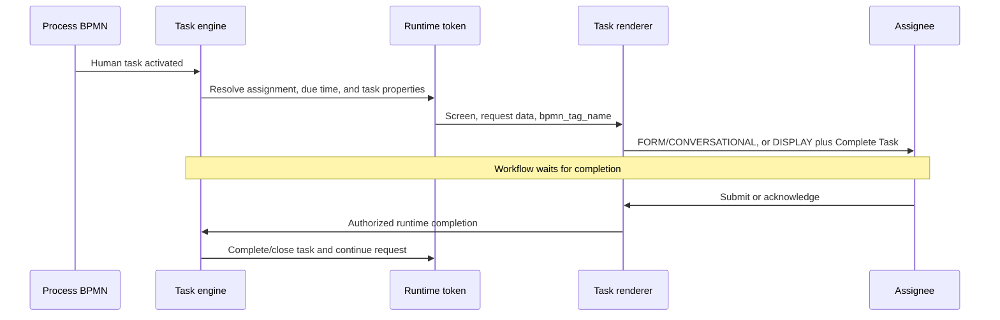

# How Form Tasks and Manual Tasks work

Source-checked against core `507f3a185`, Modeler `2ee2656a`, and Screen Builder `8bee13bc` on 2026-10-08. Package snapshots and exact source paths are in [asset-map.md](asset-map.md#source-map). These are source findings, not claims of a live-instance test.

## Design-time storage and editing

Human tasks are nodes in a process's BPMN, not separate design-time task records. Their `pm:*` attributes use the ProcessMaker namespace. The Modeler creates Form Tasks as `bpmn:Task` and Manual Tasks as `bpmn:ManualTask`; imported `bpmn:UserTask` is also registered through the task component.

- `processes.bpmn` and `process_versions.bpmn` hold process XML. Draft and published versions are distinct.
- The process API's `/bpmn` endpoint returns raw XML. A normal process response can omit BPMN; an omitted field is not an empty process.
- Designer autosave uses `PUT /processes/{id}/draft`; its publish/save path uses `PUT /processes/{id}`. A direct process PUT creates a published version through model saving.
- `ProcessController::update()` first loads the latest draft-or-published BPMN before filling submitted fields. A metadata-only PUT can therefore publish pending draft content. Inspect the intended version and send the whole intended BPMN when editing a task; do not accidentally publish someone else's draft.
- Preserve unrelated nodes, flows, BPMN DI, IDs, settings, and process metadata. Changing node type is a separate requested operation; account for incompatible screens/options and the Designer's type-replacement defaults.

Process publishing/import/export: [pm4-process](../pm4-process/SKILL.md). Screen creation/draft publishing: [pm4-screen](../pm4-screen/SKILL.md).

## Runtime path

1. `WorkflowServiceProvider` maps `manualTask` to the regular task activity implementation. It is not an auto-completing standard-BPMN placeholder.
2. `TokenRepository::persistActivityActivated()` writes the runtime node ID, activity type, assignee, Self Service pool, and due timestamp. The inspected engine uses `ProcessExecutionRawRepository::getNextUserRaw()` for assignment.
3. `TaskResourceIncludes::includeBpmnTagName()` exposes the original XML local name. A Manual Task can use the task activity implementation while retaining `bpmn_tag_name: manualTask`; do not infer its design-time type from the activity implementation alone.
4. Screen Builder's task component selects the screen renderer. FORM supplies a screen Submit action; CONVERSATIONAL selects the package component; `manualTask` gets a platform Complete Task button outside its DISPLAY content.
5. The hosting page's authorized `PUT /tasks/{runtimeTaskId}` with `status: COMPLETED` calls the workflow manager. A processed task is observed as closed; do not invent a separate Manual Task completion endpoint or a design-time create-task endpoint.

The task policy permits the assignee, Process Managers, eligible Self Service users, and administrator/anonymous handling as applicable. The renderer requires claiming a Self Service task before working it. Follow that workflow; the UI overlay is not proof the API rejects every unclaimed completion.

## Screen resolution and versions

`ProcessRequestToken::getScreen()` resolves `screenRef`; where absent it can consider existing Web Entry configuration. If no screen is found, it loads `default-display-screen` for original `manualTask`, otherwise `default-form-screen` (with a separate AI-task fallback).

Designer requires screen selection for both new task types. A fallback screen explains why an incomplete model may still render; it does not replace typed-screen lookup or content verification.

`getScreenVersion()` calls `screen->versionFor(request)`. In this checkout, `HasVersioning::versionFor()` explicitly skips version locking and returns the latest published screen version. Do not promise that a task stays on the screen version present when its request began, or that `pm:screenVersion` reliably pins it. Publishing a screen can affect in-progress tasks; confirm target-version behavior before changing shared screens.

## Assignment persistence and selection

`ProcessTaskAssignmentsTrait` runs on process saving, rebuilding assignment rows for `task`, `userTask`, `manualTask`, and call activities. It returns early when the process does not yet exist. Thus an initial API POST with `user_group` XML does not populate those rows; resave the existing process after creation. Editing an existing process through PUT rebuilds them normally.

The source selects from eligible users cyclically by sorted ID and prior assignment for this process/node, not randomly. Process-variable and group rules use the same selection path. Process-manager assignment reads managers from the request's process version and cycles when several are configured.

Important edge cases:

- Missing/invalid candidate selection can fall back to Process Managers, or fail if none are available. An empty pool is not a valid intentional assignment even if fallback allows progress.
- Self Service suppresses the ordinary assignee for supported assignment types. Its eligible user/group pool is evaluated at activation; verify it is claimable.
- Previous Task Assignee uses the latest task token by ID in the current request, not a named BPMN predecessor. Parallel work should not rely on an unspecified “previous” role.
- Assignment lock retrieves the previous assignee for this node/request, but matching rule-expression selection is evaluated before the lock branch. Do not promise lock overrides every assignment mode.
- Automatic user-manager escalation is conditional on the `workflow.UserManager` binding and the `Assignment process` integration. The separate assignee-triggered escalation flag is checked before `#manager` reassignment, whose actual manager resolution also uses that binding.

Contracts and examples: [bpmn-attrs.md](bpmn-attrs.md#pmassignment-values). No assignment, claim, or reassignment may be performed as a side effect of a configuration-only request.

## Task notifications: metadata, not BPMN flags

The inspector reads `process.task_notifications` and keeps each node's selections in `node.notifications`. `ModelerApp::getTaskNotifications()` sends a node-ID-keyed map alongside BPMN during both autosave and publish.

`ProcessController::saveTaskNotifications()` stores selected combinations in `process_notification_settings`, with process ID, BPMN `element_id`, `notifiable_type`, and `notification_type`. Supported UI combinations are requester/assignee/participants/manager × assigned/completed/due.

- `true` creates the matching setting; `false` deletes it. Omitted combinations remain unchanged. A BPMN-only PUT does not call this saver.
- `task_notifications` is handled separately from model fill; `notification_settings` is not a raw model-write substitute.
- **Draft caveat:** `updateDraft()` calls this saver before `saveDraft()`. Notification rows are process-scoped and can change even while BPMN remains an unpublished draft. Do not describe notification changes as safely isolated in a draft.
- Runtime `getNotifiables()` reads the current process's setting rows for this node/event, not a notification snapshot from the request's process version. Existing requests may observe changed settings.
- Activation sends assigned notifications only when the token has an assignee; Self Service claiming later sends activation notifications. Completion uses the completed settings.
- In this checkout, `NotificationController::index()` calls `notifyOverdueTasks()` for the current user's overdue active tasks. Do not infer independent scheduled delivery or notifications for every unclaimed task from a Due checkbox alone.
- Observed activated-notification channels are broadcast and the application's notification channel. Custom email/package listeners and delivery settings are separate. Verify actual channels and receipt rather than assuming a checkbox proves email delivery.

The explicit API contract and a selective update example are in [bpmn-attrs.md](bpmn-attrs.md#task-notification-map). Treat custom email configuration and embedded Actions by Email separately from these event-recipient flags.

## Due dates

`TokenRepository::getDueVariable()` defaults to 72 calendar hours for both task types. With `isDueInVariable` enabled and a nonempty `dueInVariable`, it Mustache-renders request data; a nonnumeric result falls back to 72. Otherwise it reads `dueIn`, defaulting to 72.

At activation, a nonzero value produces `due_at = now + hours`, including for a Self Service task waiting to be claimed. Claim/reassignment code does not recompute this timestamp. Source-level zero yields no timestamp, but the inspector deletes `dueIn` for zero and therefore restores the default instead. Do not prescribe entering zero in Designer as a reliable “no due date” setting; use a positive requested duration and verify timestamp behavior on the target version.

## Loops, destinations, and interstitials

Both task types support the Loop Activity inspector. Form Tasks include it in their definition; Manual Tasks receive it through `addLoopCharacteristics.js`. Standard loop and multi-instance settings are BPMN child structures (`loopCharacteristics` and associated I/O references), not invented keys inside `pm:config`.

Use [pm4-process](../pm4-process/SKILL.md) for graph/boundary-event structure and [pm4-expressions](../pm4-expressions/SKILL.md) for expression guidance. Preserve existing loop data references and validate multiple human completions on an authorized test process before asserting advanced behavior.

Task destination is inspector-generated JSON. The current Modeler includes Display Next Assigned Task in the destination dropdown; `TaskInterstitial` responds by updating `allowInterstitial` and selecting a DISPLAY screen. Older docs describe it as a separate toggle. Alternative destinations/conditional redirects can alter next-task behavior; preserve emitted flags rather than changing a URL alone.

Runtime uses the configured interstitial or the system `interstitial` screen and loads the next available assigned task as applicable. That is a UI transition after completion, not a way to complete or skip another human task.

## Verification status and limitations

These behaviors were traced through the inspected source. Live Designer validation, assignee/claim/reassignment behavior, notification delivery, timestamp observations, loop execution, and redirects remain target-instance checks. Record the actual release, packages, actor, and expected-versus-actual results in [verify.md](verify.md#runtime-only-if-explicitly-requested) runs. Do not “fix” platform behavior in this skills ticket or count stub edits as engine tests.
