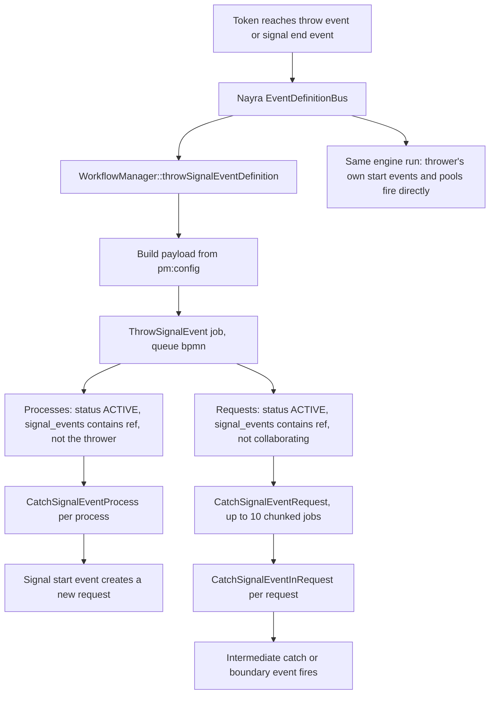

# How signals work

Source: `processmaker` core. Signals are part of Nayra (the BPMN engine) plus a ProcessMaker layer that broadcasts them **across processes and requests** through the `bpmn` queue.

A thrown signal never fails the thrower. If nothing catches it, nothing happens, and nothing is logged. Most signal bugs look like "the signal did nothing".

## Where signals live

There is **no signals table**. A signal is a `<bpmn:signal id="..." name="..." detail="...">` element in the `<bpmn:definitions>` of a process's BPMN.

- **Global signals** (the ones listed under Designer > Signals) are stored in a hidden process named `global_signals` in the system category. It is seeded by `database/seeders/SignalSeeder.php` from `database/processes/GlobalSignals.bpmn`. `POST /api/1.0/signals` appends a `<bpmn:signal>` to that process.
- **Local signals** exist only inside the BPMN of the process that uses them. The Modeler creates one in `rootElements` when you type a new signal ref.
- `SignalManager::getAllSignals()` builds the signal list by **parsing the BPMN of every process** and merging by `id`. Every list, show, create, update, and delete pays that cost. On instances with many processes the Signals page and API are slow.

A signal's identity is its **`id`** (the `signalRef`). The `name` is only a label. Events match on `signalRef`, never on name.

## Throw flow

1. **Throw.** When a token reaches an intermediate signal throw event or a signal end event, Nayra dispatches the signal on the engine's `EventDefinitionBus`. `WorkflowServiceProvider` attaches a listener that calls `WorkflowManager::throwSignalEventDefinition($eventDefinition, $token)`.
2. **Payload.** That method reads `pm:config` from the `signalEventDefinition` and builds the payload (all data, none, one variable, or an expression). See [config-attrs.md](config-attrs.md#throw-payload).
3. **Broadcast.** It dispatches `ThrowSignalEvent($signalRef, $data, $excludeProcesses, $excludeRequests)` on the `bpmn` queue. **Without a queue worker on `bpmn`, nothing is delivered.**
4. **Start events.** `ThrowSignalEvent` selects processes with `status = 'ACTIVE'` whose `signal_events` JSON contains the ref. It dispatches one `CatchSignalEventProcess` per process.
5. **Waiting requests.** It counts requests with `status = 'ACTIVE'` whose `signal_events` contains the ref. It splits them into chunks of `ceil(count / 10)` and dispatches one `CatchSignalEventRequest` per chunk. Each chunk calls `CatchSignalEventInRequest` synchronously for each request.

`WorkflowManager::throwSignalEvent($signalRef, $data)` starts at step 3. Code uses it to throw without a BPMN element:

| Signal id | Thrown by | Payload |
|-----------|-----------|---------|
| `collection_{id}_create\|update\|delete` | `package-collections` `RecordObserver` ([collections.md](collections.md)) | record `data` |
| `start_ldap_sync` | `package-auth` `SettingObserver` | `{}` |
| `abe_stop_handler` | `package-actions-by-email` `StopHandlerProcess` | `{}` |

The docs also describe "User Signals" (user created, deleted, and so on). No thrower for them exists in core or in the packages checked here. Confirm on the instance (`GET /api/1.0/signals`) before relying on one.

## Routing: the `signal_events` columns

Delivery does not scan BPMN. It reads a JSON column that must already hold the ref:

| Column | Holds | Updated by |
|--------|-------|------------|
| `processes.signal_events` | `signalRef`s of the process's **start events** | `ProcessObserver::saving` → `Process::getUpdatedStartEventsSignalEvents()`, from `start_events` |
| `process_requests.signal_events` | `signalRef`s of **active tokens** on intermediate catch events and on activities with boundary signal events | `ProcessRequest::updateCatchEvents()`, called from `TokenRepository` when tokens are persisted |

Consequences:

- A signal start event only receives signals once the process has been **saved** with that start event. Editing the BPMN directly in the database does not update the column.
- A request only receives the signal **while** a token is waiting on the catch event, or on the activity that carries the boundary event. A signal thrown one moment earlier is lost. Signals are not queued for later.
- Processes that are not `ACTIVE` (inactive, archived) never start from a signal.

## Exclusions

- **The throwing process** is excluded from the queue broadcast (`$excludeProcesses`), so no `CatchSignalEventProcess` runs for it.
- **But the thrower still catches its own signal locally.** Inside the thrower's own engine run, Nayra's `EventDefinitionBus` delivers the signal straight to the loaded definitions. A **signal start event in the throwing process starts a new request of that process**, with the payload in its Request Variable (verified on a running instance). This is also how pools of the same model receive it; the docs say they "also trigger".
  - **Loop risk:** if the path after that start event throws the same signal again, every request starts another one. Never throw a signal on the path that its own start event begins.
- **Collaborating requests** (the throwing engine's execution instances, such as pools of the same collaboration) are excluded from the request broadcast; they only get the local delivery above.
- `CatchSignalEventInRequest` runs with global events disabled, so a caught signal is not re-broadcast.
- `CatchSignalEventInRequest` also sets `setDoNotTriggerStartEvents(true)`: request delivery only fires intermediate and boundary events. Start events are only reached through `CatchSignalEventProcess`.

## Catching and where the payload lands

**Start event** (`CatchSignalEventProcess`):
- Loads the process's latest **published** version (`getLatestVersion()` filters `published()`; with A/B alternatives it uses `A`), and dispatches the signal into a fresh engine.
- If the start event has `pm:config="varName"`, the whole payload is stored under `varName`. If not, each top-level payload key is written to the root of the new request's data.
- An empty payload (`NONE`, or `REQUEST_VARIABLE` with an empty variable) still sets `varName` to `[]` on the new request.
- **Known bug:** the variable is taken from the `pm:config` of the **last** event in the XML that references the signal, not from the start event that fired. If the same process also has an intermediate or boundary catch of that signal later in the file, the new request gets the payload under that event's variable, and its own variable is `[]`. See [verify.md](verify.md#known-issues).

**Intermediate catch or boundary event** (`CatchSignalEventInRequest`):
- Dispatches the signal into the request's engine. Then, for every catch event of that ref that holds a token in this request, it applies the same rule: `pm:config` variable, or merge into the root.
- A root merge **overwrites** request variables that share a name with payload keys. With `ALL_REQUEST_DATA` from the thrower, that can be many variables. Prefer a `pm:config` variable on the catch, or `REQUEST_VARIABLE` on the throw.

## Other workflow managers

`WorkflowManagerRabbitMq` (and `WorkflowManagerKafka`, which extends it) overrides `throwSignalEventProcess` and `throwSignalEventRequest`. It wraps the payload under the `pm:config` variable and sends a `TRIGGER_SIGNAL_EVENT` action to the Nayra microservice instead of running the engine in PHP. The start-event path uses `getPublishedVersion($data)`. Selection and exclusion (`ThrowSignalEvent`) are the same.

## Signal management rules

From `SignalManager` and `Api/SignalController`:

- **ID** must match `^[a-zA-Z_][\w.-]*$` and be unique across all processes. **Name** is required.
- **Update** is refused (403) when a system process catches the signal. **Delete** is refused (403) when any process, system or not and **archived included**, has a catch or throw event that references it.
- Update rewrites the id and name in **every** process that uses the signal (`replaceSignal`). Changing an id therefore changes the `signalRef` of every event that uses it.
- Delete removes the `<bpmn:signal>` element from every process that declares it.
