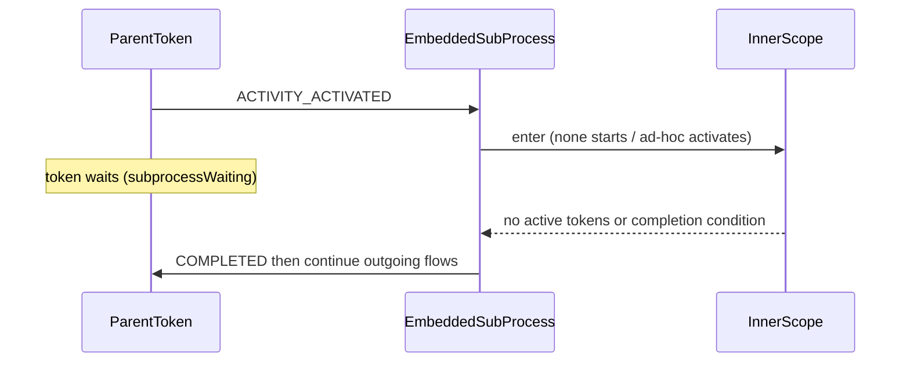
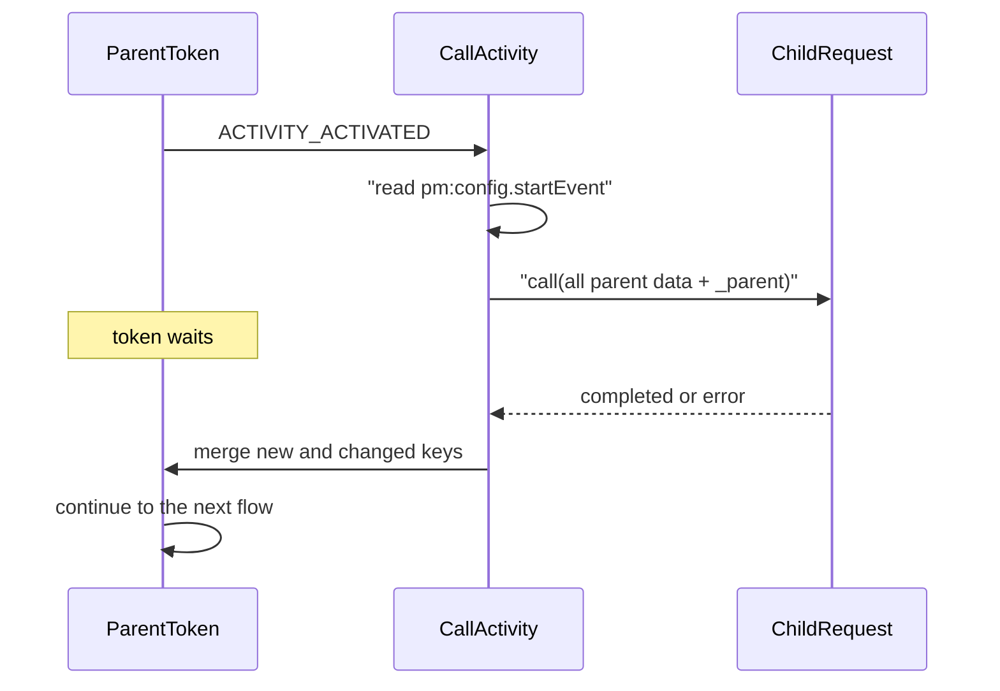

# How subprocesses run

Two runtimes. Do not mix their assumptions.

| | Embedded / Ad-hoc / Transaction | Call Activity |
|--|----------------------------------|---------------|
| BPMN | `bpmn:subProcess`, `bpmn:adHocSubProcess`, `bpmn:transaction` | `bpmn:callActivity` |
| Request | Same parent request | New child request |
| Data | Shared instance data store | Copy in + merge new/changed keys back |
| Waiting | Parent activity token waits on inner scope | Parent token waits on child request |
| Engine | Nayra `ScopeExecution` / embedded traits | `ProcessMaker/Models/CallActivity.php` |

File paths for Call Activity: [asset-map.md](asset-map.md). Design choice: [design.md](design.md). BPMN attrs: [SKILL.md](SKILL.md).

## Embedded runtime (same request)

1. The parent token activates the subprocess activity.
2. If `triggeredByEvent` is false, the engine creates a child **scope** on the same execution instance and starts inner none start events (or activates ad-hoc activities).
3. Inner tasks, gateways, and events run with the **same** request data. No `_parent` copy, no second process version.
4. When the scope has no active tokens (or an ad-hoc completion condition succeeds), the parent activity completes and sequence flows leave the subprocess.
5. Event subprocesses (`triggeredByEvent=true`) are not entered via sequence flow; their message/signal/timer starts subscribe on the parent instance.
6. Transactions may cancel via cancel end events and activate `isForCompensation` activities without taking success flows.

Nested embedded subprocesses create nested scopes. Sequence flows must remain inside each container.

## Call Activity runtime (separate request)

Checked against `ProcessMaker/Models/CallActivity.php` and the modeler Sub Process node.

1. The parent token reaches the Call Activity. `initActivity` reads `pm:config.startEvent`.
2. `callSubprocess` copies the parent data model (`DataManager::getData`), adds `_parent`, resolves the child with `getCalledElement`, and starts it with `call($dataStore, $startEvent)`.
3. `persistCallActivityActivated` sets the child's `parent_request_id` to the parent request, and the parent token's `subprocess_request_id` / `subprocess_start_event_id`.
4. The parent token stays active until the child request completes. A parallel gateway lets **other** parent tokens continue. It does not make this node return early. Inbox `GET /tasks` lists Form Tasks only. The Call Activity token is `element_type` `callActivity`: `GET /tasks?process_request_id={parentId}&all_tasks=true`, or `GET /requests/{parentId}/tokens?element_id={callActivityId}`. `subprocess_request_id` on that token is the child request.
5. On completion, new and changed keys merge back into the parent (`completeSubprocess`). On error, the child's message is logged on the parent token (`catchSubprocessError`).

### `calledElement`

The stored value is `{startEvent.ownerProcessId}-{childProcess.id}`, for example `ProcessId-34`. The engine splits on the last `-`:

| Parts | Meaning |
|-------|---------|
| One | Same BPMN document (`getElementInstanceById`). Not what Modeler writes for a Sub Process |
| Two, numeric suffix | Child process row (`Process::findOrFail`). Call Activity path |
| Two, non-numeric suffix | Service subprocess (`package_key`). Data Connector (`isServiceSubProcess`) |

`getCalledElement` loads the child's **published** version (`getPublishedVersion($data)`), unless the parent token is already linked to a subprocess request (reuse that request's `processVersion`).

`pm:config.startEvent` is the element id passed to `call()`. An empty `calledElement` does not start a child.

### Data copy and merge-back

There is no field-mapping control on the node.

**Into the child** (`callSubprocess`):

- The whole parent data model is copied.
- `_parent.process_id`, `_parent.request_id`, `_parent.node_id` are set from the parent token.
- `_parent.config` is the decoded `pm:config` of this node, when present.
- Nested Call Activities can already have a `_parent` object; this node fills missing keys rather than replacing the object.
- `persistInstanceCreated` reads `_parent.request_id` to set the child's `parent_request_id`.

`GET /api/1.0/requests/{id}?include=data` drops every key that starts with `_`. Copied business keys remain. The durable parent link is `parent_request_id`.

**Back into the parent** (`completeSubprocess`):

1. Keys the child marked updated (`getUpdated()`), if present.
2. Keys that exist only in the child (`mergeNewKeys`).
3. Keys that exist on both sides and differ (`mergeChangedKeys`).

Unchanged parent keys stay. `_parent` is reserved and is not written back onto the parent.

### Errors, parent request, and redirect

- Child has `parent_request_id`. Parent token has `subprocess_request_id`.
- `HandleEndEventRedirect` skips requests with `parent_request_id`.
- `catchSubprocessError` logs the child's error on the parent token.

### Loop and Multi-instance

The modeler injects Loop Activity for `bpmn:CallActivity`. Each loop iteration is another child request. Write FEEL exit conditions with [pm4-expressions](../pm4-expressions/SKILL.md).

## What each path is not

- Embedded is **not** a second ProcessMaker request and does **not** use `calledElement`.
- Call Activity is **not** for collapsing nodes that only need visual grouping — use embedded.
- Neither path is a Data Connector call (`calledElement` suffix non-numeric).
