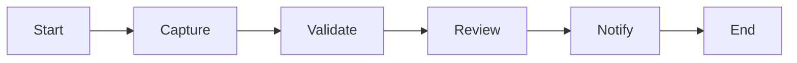
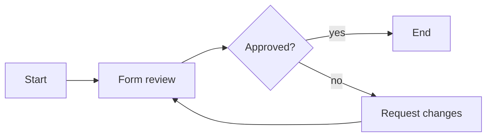

# Subprocess design: keep large diagrams readable

Goal: humans (and agents) should understand the **story of the process** at a glance. A flat canvas with dozens of tasks, gateways, and crossings is hard to review, test, and change. Prefer **phase boxes** (embedded subprocesses) that hide detail until you open them.

## Top-level story

Write the parent process as a short sequence of named phases, for example:

```
Start → Capture → Validate → Review → Notify → End
```

Each phase is an embedded `bpmn:subProcess` (or Call Activity only when reuse requires it). Inside “Review” put the forms, scripts, exclusive gateways, and loops that belong to that phase.



Inside `Review` (collapsed on the parent):



## When to embed (default)

Use `bpmn:subProcess` when **all** of these hold:

- The work is one coherent business phase of **this** process.
- It should share the **same request** and data model (no child request).
- The phase has **2+** flow nodes (tasks, scripts, gateways) that clutter the parent.
- You want a cleaner layout: fewer crossing edges, shorter swimlanes, clearer ownership.

Also embed when:

- Nesting a sub-phase inside a larger phase (e.g. “Review” contains “Committee vote”).
- A gateway fan-out/fan-in belongs entirely to one phase (put the parallel split/join inside the subprocess).

## When to use Ad-hoc

Use `bpmn:adHocSubProcess` when:

- Several tasks may run in any order (or optionally).
- Completion is “enough is done” via a completion condition, not a fixed sequence.

Do not use ad-hoc for a fixed Start → A → B → End chain; that is a normal embedded subprocess.

## When to use Transaction

Use `bpmn:transaction` when the phase needs BPMN cancel/compensation semantics. For ordinary grouping, prefer `bpmn:subProcess`.

## When to use Call Activity

Use `bpmn:callActivity` when **any** of these hold:

- The child is (or should be) a **reusable** published process used from multiple parents.
- You need a **separate request** (audit trail, independent inbox lifecycle, `parent_request_id`).
- You are wiring a **PM Block**, Actions by Email, or another packaged call.
- An existing asset already lives as its own BPMN file (e.g. shared upload transcript process).

Do **not** create a new child process solely to reduce visual noise. Embed instead.

## Sizing heuristics

| Parent top-level nodes (rough) | Action |
|--------------------------------|--------|
| ≤ 8 tasks/gateways | Flat is fine; embed only if a named phase helps readers |
| 9–20 | Extract at least one embedded phase |
| > 20 | Split into multiple named embedded phases; nest if needed |
| Same sequence copied in 2+ processes | Extract a Call Activity / PM Block |

Name phases with business language (`Validate documents`), not technical labels (`Sub1`).

## Layout tips

- Parent: left-to-right (or top-to-bottom) **phases only**; avoid long diagonal spaghetti.
- Put gateways that only serve one phase **inside** that subprocess.
- Keep message/signal collaborations and reusable calls as Call Activities or signal skills; do not bury a reusable process inside a one-off embed if other parents need it.
- One responsibility per subprocess; if the name needs “and”, split.

## Package / AI authoring checklist

When generating BPMN under `projects/{slug}/bpmn/`:

1. Outline phases in `architecture/workflow.md` first.
2. Emit parent Start → phase subprocesses → End.
3. Fill each subprocess with its tasks/screens/scripts.
4. Use Call Activity only for documented reusable processes (see project `AGENTS.md`).
5. Run [verify.md](verify.md) for containment and naming.
